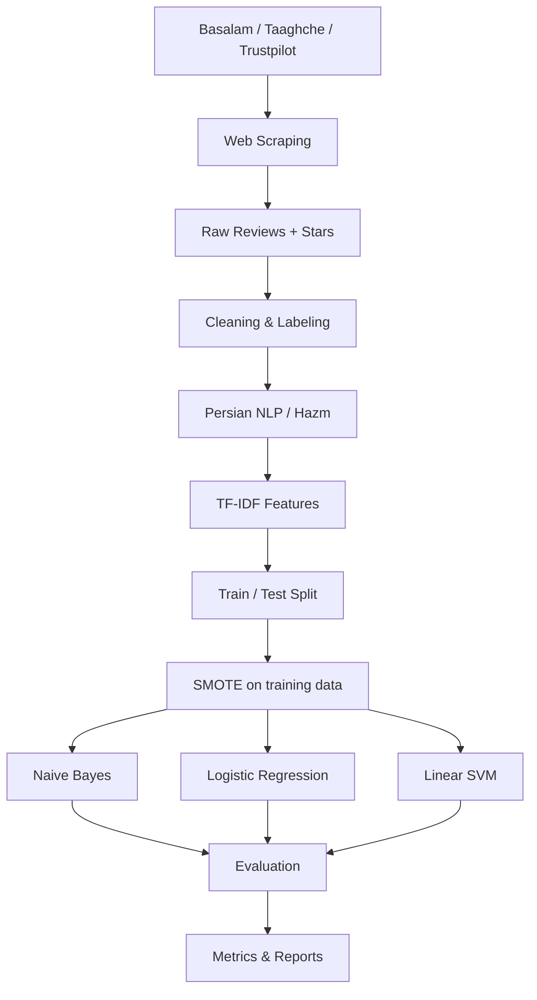

<div align="center">

# Sentiment Analysis Reviews

### از یک نظر تا یک تصمیم؛ آزمایشگاه تعاملی تحلیل احساسات

روایتی بصری از مسیر استخراج دیدگاه کاربران، پردازش زبان طبیعی، ساخت ویژگی، آموزش مدل‌های یادگیری ماشین و ارزیابی آن‌ها.

[مشاهده آزمایشگاه آنلاین](https://amirhosseinrezaaie.github.io/Sentiment-Analysis-Reviews/)


</div>

---

## تجربه پروژه

این پروژه بررسی می‌کند که چطور می‌توان از دیدگاه‌های پراکنده کاربران، داده‌ای ساختاریافته تولید کرد و با کمک مدل‌های یادگیری ماشین احساس مثبت یا منفی متن را تشخیص داد.

رابط تعاملی پروژه، این مسیر را به هفت ایستگاه تبدیل می‌کند. با اسکرول صفحه، هر مرحله همراه با یک نمایش بصری توضیح داده می‌شود و در پایان می‌توان تنظیمات آزمایشی را تغییر داد و یک متن دلخواه وارد کرد.

**[ورود به آزمایشگاه تحلیل احساسات](https://amirhosseinrezaaie.github.io/Sentiment-Analysis-Reviews/)**

## مسیر تحلیل

| مرحله | کار انجام‌شده | فناوری‌ها و خروجی |
|---|---|---|
| ۱. Web Scraping | استخراج دیدگاه‌ها از صفحات وب | Python، Selenium، BeautifulSoup، CSV |
| ۲. Dataset & Labels | اتصال متن نظر به امتیاز و برچسب احساس | متن، ستاره، کلاس مثبت/منفی |
| ۳. NLP | نرمال‌سازی، پاک‌سازی، توکن‌سازی و حذف توقف‌واژه‌ها | Hazm، Regex |
| ۴. Feature Engineering | تبدیل متن به ویژگی‌های عددی | TF-IDF، Unigram و Bigram |
| ۵. Machine Learning | آموزش و مقایسه طبقه‌بندها | MultinomialNB، Logistic Regression، Linear SVM |
| ۶. Evaluation | سنجش کیفیت پیش‌بینی | Accuracy، Precision، Recall، F1، Confusion Matrix |
| ۷. Playground | تجربه تعاملی تنظیمات و ورود متن | رابط Next.js؛ اتصال مدل واقعی در گام توسعه بعدی |

## پیش‌نمایش معماری



## ساختار مخزن

```text
SentimentProject/
├── app/                         # نقطه ورود خط فرمان
├── src/sentiment_analysis/
│   ├── scraping/                 # scraperها و مدیر استخراج
│   └── preprocessing/            # کدهای پیش‌پردازش
├── notebooks/experiments/        # آزمایش‌های Basalam، Taaghche و Trustpilot
├── data/                         # داده خام و پاک‌سازی‌شده
├── models/                       # مدل‌ها، TF-IDF و مقایسه نتایج
├── figures/                      # نمودارها و ماتریس‌های درهم‌ریختگی
├── files/                        # داده‌های جانبی و مجموعه‌های آزمون
├── reports/                      # گزارش‌های پروژه
├── frontend/                     # رابط تعاملی Next.js
└── .github/workflows/            # ساخت و انتشار خودکار GitHub Pages
```

## داده‌ها و مدل‌ها

نوت‌بوک‌های آزمایش موجود شامل پاک‌سازی متن، آماده‌سازی داده، TF-IDF با حداکثر ۱۰٬۰۰۰ ویژگی و بازه n-gram برابر (۱، ۲)، تقسیم آموزش/آزمون با نسبت ۸۰/۲۰ و `random_state=42` هستند. در شاخه‌های آزمایشی، SMOTE روی داده آموزش اعمال شده است.

مدل‌های ذخیره‌شده و مقایسه‌شده در آزمایش‌ها:

- **Multinomial Naive Bayes**
- **Logistic Regression** با `class_weight='balanced'`
- **Linear SVM** با `class_weight='balanced'`

### اعداد ثبت‌شده در فایل مقایسه

مقادیر زیر مستقیماً از `models/model_comparison.csv` خوانده شده‌اند:

| مدل | Accuracy | Precision کلاس مثبت | Recall کلاس مثبت | F1 کلاس مثبت |
|---|---:|---:|---:|---:|
| MultinomialNB | 65.79% | 100.00% | 64.86% | 78.69% |
| Logistic Regression | 66.84% | 99.19% | 66.49% | 79.61% |
| Linear SVM | 66.84% | 99.19% | 66.49% | 79.61% |

این اعداد خروجی تاریخی یک آزمایش هستند و معیار عملکرد تضمین‌شده یا نتیجه نهایی پروژه محسوب نمی‌شوند. گزارش PDF موجود اعداد دیگری دارد؛ پیش از نتیجه‌گیری باید منبع داده، تقسیم‌بندی و تنظیمات ارزیابی همه مدل‌ها یکسان و دوباره اجرا شوند.

**نکته کیفیت داده:** در بررسی فایل‌های فعلی، داده پاک‌سازی‌شده Trustpilot شامل ۱٬۲۰۰ ردیف با برچسب صفر است. چنین مجموعه تک‌کلاسه‌ای برای ارزیابی طبقه‌بندی دودویی مناسب نیست و برچسب‌گذاری آن باید اصلاح شود. داده‌های موجود همچنین عدم‌توازن شدید کلاس‌ها را نشان می‌دهند؛ بنابراین گزارش معیارهای هر کلاس و Macro-F1 اهمیت دارد.

## اجرای بخش پایتون

Python 3.10 یا جدیدتر پیشنهاد می‌شود.

```bash
python -m venv .venv

# Windows
.venv\Scripts\activate

# Linux / macOS
source .venv/bin/activate

pip install -r requirements-core.txt
```

برای پردازش فارسی و scraping، وابستگی‌های مربوط را نیز نصب کنید:

```bash
pip install -r requirements-persian.txt
pip install -r requirements-scraping.txt
```

نمای کلی فرمان‌ها:

```bash
python -m app.main overview
python -m app.main notebook basalam
python -m app.main notebook taaghche
python -m app.main notebook trustpilot
```

استخراج دیدگاه از URL:

```bash
python -m app.main scrape-url "https://basalam.com/..."
python -m app.main scrape-url "https://taaghche.com/book/..." --headless
python -m app.main scrape-url "https://www.trustpilot.com/review/example.com"
```

اجرای scraperها به Chrome و ChromeDriver سازگار نیاز دارد. ساختار HTML وب‌سایت‌ها ممکن است تغییر کند و selectorهای استخراج باید متناسب با آن به‌روزرسانی شوند.

## اجرای رابط کاربری

```bash
cd frontend
npm ci
npm run dev
```

برای ساخت نسخه static:

```bash
npm run build
```

خروجی قابل انتشار در `frontend/out/` ساخته می‌شود. رابط برای GitHub Pages پیکربندی شده است.

### وضعیت آزمایشگاه تعاملی

نسخه فعلی فرانت‌اند یک نمونه نمایشی سمت مرورگر است. انتخاب مدل، n-gram، تعداد ویژگی‌ها و سهم آزمون در رابط قابل تغییر است؛ پیش‌بینی متن در این نسخه با قواعد ساده واژگانی شبیه‌سازی می‌شود و اجرای مدل‌های pickle پایتون یا آموزش مجدد مدل در مرورگر انجام نمی‌شود. گزینه Random Forest نیز برای نمایش مسیر توسعه آینده اضافه شده و جزو مدل‌های آموزش‌دیده فعلی نیست.

گام بعدی برای تبدیل این محیط به ابزار آزمایش واقعی، ساخت API پایتون برای بارگذاری Pipeline سازگار، اعمال تنظیمات آموزش/ارزیابی، پیش‌بینی متن با همان پیش‌پردازش زمان آموزش و بازگرداندن خروجی و معیارهای قابل بازتولید است.

## انتشار خودکار

Workflow در `.github/workflows/deploy-pages.yml` با هر push مرتبط به شاخه `main` اجرا می‌شود، وابستگی‌های فرانت‌اند را نصب می‌کند، خروجی static را می‌سازد و آن را روی GitHub Pages منتشر می‌کند.

در تنظیمات مخزن GitHub، بخش **Settings → Pages → Build and deployment** باید روی **GitHub Actions** قرار بگیرد. پس از موفقیت اولین اجرای workflow، نشانی سایت در بخش Pages و خروجی مرحله Deploy نمایش داده می‌شود.

## نقشه راه

- [x] یکپارچه‌سازی scraperهای Basalam، Taaghche و Trustpilot
- [x] ثبت آزمایش‌های NLP و مدل‌های کلاسیک در نوت‌بوک‌ها
- [x] رابط داستان‌محور و اسکرولی برای نمایش مراحل پروژه
- [x] نمونه اولیه آزمایشگاه تعاملی در فرانت‌اند
- [ ] یکسان‌سازی schema و برچسب‌گذاری داده‌ها
- [ ] ساخت Pipeline قابل بازتولید برای آموزش و ارزیابی
- [ ] ارائه API برای پیش‌بینی با مدل واقعی
- [ ] اتصال Playground به API و نمایش معیارهای زنده
- [ ] اعتبارسنجی مجدد مدل‌ها و ثبت نسخه داده و مدل

---

<div align="center">

ساخته‌شده برای تبدیل داده‌های متنی به بینش قابل استفاده.

**Sentiment Analysis Reviews**

</div>
